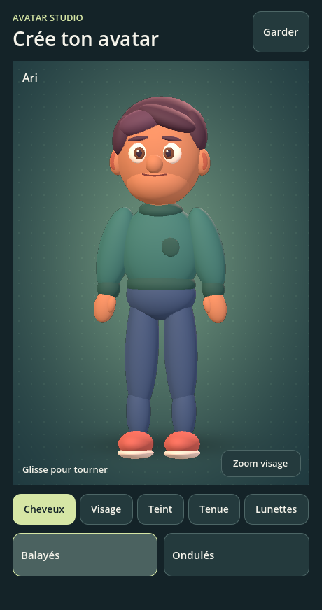

# Avatar Studio

Créateur d’avatars 3D pour Godot. Choisis une coiffure, un teint, une expression, des lunettes et une tenue. Le personnage est visible sous tous les angles. Chaque application peut fournir son propre catalogue et appliquer sa propre présentation.

Ari, le personnage de la démo, a été créé pour ce dépôt. La démo utilise des ressources locales. Le code de personnalisation est indépendant de l’écran et de l’enregistrement de la démo.



## Essayer

Ouvre `project.godot` dans Godot 4 et lance le projet. Glisse sur l’aperçu pour tourner Ari. **Garder** enregistre le choix sur cet appareil. Le projet a été vérifié sous Godot 4.7.2 en mode Compatibility.

## Ajouter le créateur à un autre projet

Copie `addons/avatar_studio/` dans ton projet et ajoute un catalogue local JSON et son modèle 3D. Le catalogue de démonstration est dans `demo/modeles/`.

Avec l’écran fourni :

```gdscript
var studio := AvatarStudioEditor.new()
studio.catalogue_path = "res://avatars/catalogue.json"
studio.save_requested.connect(_save_look)
add_child(studio)
studio.set_anchors_and_offsets_preset(Control.PRESET_FULL_RECT)
```

L’application reçoit un dictionnaire d’identifiants. Elle choisit comment le sauvegarder. Pour charger une apparence déjà enregistrée, appelle `studio.restore(choices)` après le signal `catalogue_loaded`.

Pour utiliser uniquement le personnage, instancie `AvatarStudioCharacter`, appelle `configure(catalogue_path)`, puis `choose(category, option)`. `get_choices()` renvoie une copie indépendante. `restore(choices)` accepte un ensemble complet de choix et refuse les identifiants inconnus sans modifier le personnage.

### Catalogue

`model` référence une scène 3D Godot ou un GLB par chemin local. `name` fournit le nom affiché. Chaque catégorie possède un identifiant, un libellé, au moins une option et un identifiant par défaut.

| Option | Effet |
| --- | --- |
| `group` | Affiche le nœud 3D nommé, par exemple une coiffure ou un haut. |
| `morph` et `weight` | Appliquent une déformation nommée. Le poids va de 0 à 1. |
| `material` et `color` | Changent la couleur d’un matériau standard sur cet avatar. |
| `clear: true` | Retire les options de la catégorie, par exemple les lunettes. |

Les nœuds interchangeables doivent avoir des noms uniques. Évite de piloter le même nœud, matériau ou morph depuis deux catégories. Pour un export Godot, ajoute les catalogues `*.json` aux filtres d’inclusion.

### Vérifier et régénérer la démo

```sh
godot --headless --path . --import
godot --headless --path . --script tests/test_character.gd
godot --path . --script tests/capturer.gd
```

Le premier test vérifie notamment l’indépendance de deux avatars et l’import d’un catalogue différent. Le second utilise les boutons de l’écran réel avec le rendu graphique actif. Pour régénérer le modèle Ari, lance `godot --headless --path . --script sources/generate_demo.gd`.

## État du projet

Première démo locale. Ari utilise une pose fixe et une déformation pour le sourire. Les animations du corps, les aperçus de chaque option et les essais sur téléphone restent à développer. Le dépôt est destiné à une revue privée avant toute diffusion. La licence du code et des ressources originales reste à valider. Une option à considérer est MIT pour le code, avec une licence distincte et explicite pour les modèles.
